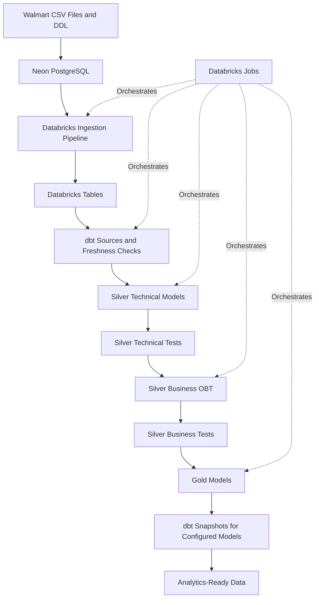

# Walmart End-to-End Data Engineering Project

An end-to-end data engineering project that moves Walmart retail data from PostgreSQL into Databricks, transforms it with dbt, validates data quality, tracks historical changes with snapshots, and orchestrates the workflow using Databricks Jobs.

**Repository:** https://github.com/wisdomnwachukwu/walmart-dbt-project

## 1. Project Overview

This project demonstrates a practical data engineering workflow using a Walmart retail dataset.

The source data is loaded into **Neon PostgreSQL**, ingested into **Databricks** using an incremental/upsert-oriented pipeline, and transformed with **dbt Core** into technical, business, and Gold-layer models.

The project also incorporates source-freshness checks, dbt tests, reusable testing macros, snapshots for configured models, and workflow orchestration. GitHub Copilot and Neon MCP assisted with database setup and development.

## 2. Architecture



*This is a conceptual diagram. Confirm the exact task dependencies and snapshot order against the current implementation before treating it as a precise execution graph.*

## 3. Technology Stack

- **Neon PostgreSQL:** Source relational database
- **Databricks:** Data ingestion, storage, and processing
- **dbt Core:** SQL transformations, testing, model dependencies, and snapshots
- **Databricks Jobs:** Final successful workflow orchestration
- **Apache Airflow:** Alternative orchestration approach explored during development
- **Python:** Ingestion and workflow-related code
- **GitHub:** Version control and project documentation
- **GitHub Copilot and Neon MCP:** AI-assisted database setup and development

## 4. Source Data

The project uses Walmart CSV datasets and a supplied DDL/schema definition.

The source tables include:

- `customers`
- `employees`
- `order_items`
- `orders`
- `products`
- `stores`

GitHub Copilot, connected through Neon MCP, assisted with creating and populating the PostgreSQL tables using the supplied data and schema information.

## 5. Data Pipeline Implementation

### Stage 1: Source Database Setup

Neon PostgreSQL serves as the source database. The supplied CSV data and DDL were used to create and populate the tables.

Key considerations include appropriate column types, preservation of relationships between business entities, and validating that the data loads successfully.

### Stage 2: Ingestion into Databricks

Databricks was connected to Neon PostgreSQL using PostgreSQL connection details. An ingestion pipeline was configured for incremental/upsert-oriented processing.

This separates source-system storage from the processing environment used for downstream transformations and analytics.

**Security consideration:** Database credentials and access tokens should be kept in an appropriate secret-management mechanism and never committed to GitHub.

### Stage 3: dbt Sources and Freshness Checks

dbt was connected to Databricks, and source definitions were created to represent the ingested data.

The workflow includes `dbt source freshness` to help identify upstream data that is older than expected before downstream transformations continue.

### Stage 4: Silver Technical Models

The Silver technical layer prepares source data for downstream business logic.

This layer provides a dedicated place for technical transformations and data preparation, helping make the data more consistent and easier to use in subsequent models.

The technical models are built and tested before the workflow proceeds to the business layer.

### Stage 5: Silver Business Model

A business-oriented **One Big Table (OBT)** model was created to combine relevant data for analytical use cases.

The OBT simplifies access to related business entities and provides an input for downstream Gold models.

### Stage 6: Gold Models and Historical Tracking

The Gold layer contains models intended for downstream reporting and analysis.

The project uses dbt model selection, reusable testing macros, and snapshots for configured models that require historical change tracking.

Snapshots are run separately from ordinary model builds using the dbt snapshot command.

**Technical note:** dbt ephemeral models are compiled into dependent SQL rather than materialized as standalone tables or views. Verify the Gold selectors and snapshot configurations in the repository before changing the workflow.

## 6. Workflow Orchestration

### Final Workflow: Databricks Jobs

The final successful workflow used **Databricks Jobs** to coordinate ingestion and dbt processing.

A recorded run completed successfully in approximately 19 minutes. The workflow was designed to coordinate the pipeline stages so that downstream processing follows the required upstream work.

### Earlier Approach: Apache Airflow

An Airflow DAG was also developed to explore orchestration and task dependencies.

Its intended sequence was:

1. Trigger the Databricks ingestion job and wait for it to finish.
2. Clean the dbt `target` and `logs` directories.
3. Run dbt source-freshness checks.
4. Build Silver technical models.
5. Test Silver technical models.
6. Build Silver business models.
7. Test Silver business models.
8. Run the selected Gold ephemeral models.
9. Run dbt snapshots.
10. Run the selected Gold fact models.

The local Airflow setup introduced resource overhead on the development machine, so Databricks Jobs was used for the final successful orchestration workflow.

This experience illustrates how orchestration decisions should account for the available computing environment, operational complexity, and the tools already used to process the data.

## 7. Data Quality and Reliability

The workflow incorporates several mechanisms to improve confidence in the transformed data:

- **Source freshness checks:** Identify upstream data that may be stale.
- **dbt model tests:** Validate technical and business models.
- **Reusable test macros:** Reduce repeated testing logic.
- **Snapshots:** Preserve historical changes for configured models.
- **Task dependencies:** Establish the required processing order.
- **Incremental/upsert-oriented ingestion:** Support ongoing updates without treating every run as a complete reload.

These mechanisms help identify problems earlier and make the workflow easier to maintain.

## 8. Running the dbt Workflow

The commands below reflect the selectors used in the Airflow DAG shared during development. Run them from the dbt project directory in an environment where dbt and the Databricks adapter are configured.

Verify that the selectors match the current project before executing them.

```bash
dbt source freshness

dbt run --select silver_t
dbt test --select silver_t

dbt run --select silver_b
dbt test --select silver_b

dbt run --select gold/ephemeral
dbt snapshot
dbt run --select gold/fact
```

The ingestion stage is triggered separately through the configured Databricks job. In the final workflow, Databricks Jobs coordinates the processing stages.

## 9. Engineering Challenges and Lessons

### Connecting PostgreSQL to Databricks

**Challenge:** Configure connectivity between Neon PostgreSQL and Databricks.

**Approach:** Use PostgreSQL connection details to establish the source connection and configure the ingestion pipeline.

**Lesson:** Separate connection configuration from transformation logic and protect credentials.

### Designing Layered Transformations

**Challenge:** Keep technical data preparation separate from business-oriented modeling.

**Approach:** Use dbt sources and Silver technical models before building the business OBT and Gold models.

**Lesson:** Clear model layers improve maintainability, testing, and lineage.

### Incorporating Data Quality

**Challenge:** Avoid treating successful SQL execution as the only measure of data correctness.

**Approach:** Add source-freshness checks and dbt tests at important points in the workflow.

**Lesson:** Quality checks are more useful when they run before dependent models proceed.

### Selecting an Orchestration Strategy

**Challenge:** The local Airflow setup introduced resource overhead on the development machine.

**Approach:** Use Databricks Jobs for the final successful workflow while retaining the Airflow DAG as an alternative orchestration design.

**Lesson:** Select orchestration tools based on the actual environment and operational requirements.

## 10. Security Practices

- Never commit database passwords, tokens, or sensitive connection strings.
- Use Databricks secrets or an approved secret manager for sensitive configuration.
- Use environment variables or secure job parameters where appropriate.
- If a credential has been committed, revoke or rotate it; deleting it from the latest version of a file is not sufficient.

## 11. Potential Improvements

Future enhancements could include:

- Adding explicit data-quality constraints for required fields, valid ranges, uniqueness, and referential integrity.
- Documenting the exact incremental strategy and how updates or deletes are handled.
- Adding monitoring, alerting, retry policies, and failure notifications.
- Implementing source-to-target row-count reconciliation.
- Documenting the final Databricks Job task graph with screenshots of successful runs.
- Adding a data model diagram and definitions of key business metrics.
- Introducing CI checks for dbt parsing and relevant tests.
- Recording performance and cost considerations for ingestion and transformation workloads.

## 12. Skills Demonstrated

This project demonstrates practical experience with:

- Relational data ingestion from PostgreSQL into Databricks
- Incremental/upsert-oriented pipeline design
- dbt sources and freshness checks
- Layered SQL transformations
- Technical and business data modeling
- One Big Table design
- dbt testing and reusable macros
- Historical change tracking with snapshots
- Workflow orchestration using Databricks Jobs
- Evaluating an Airflow-based alternative
- AI-assisted development using GitHub Copilot and Neon MCP

## Repository

**Explore the project:** https://github.com/wisdomnwachukwu/walmart-dbt-project

---

*This documentation is based on the project details recorded during development. Confirm exact file paths, model selectors, snapshot configurations, and current job dependencies against the repository before publishing this as a definitive implementation reference.*
